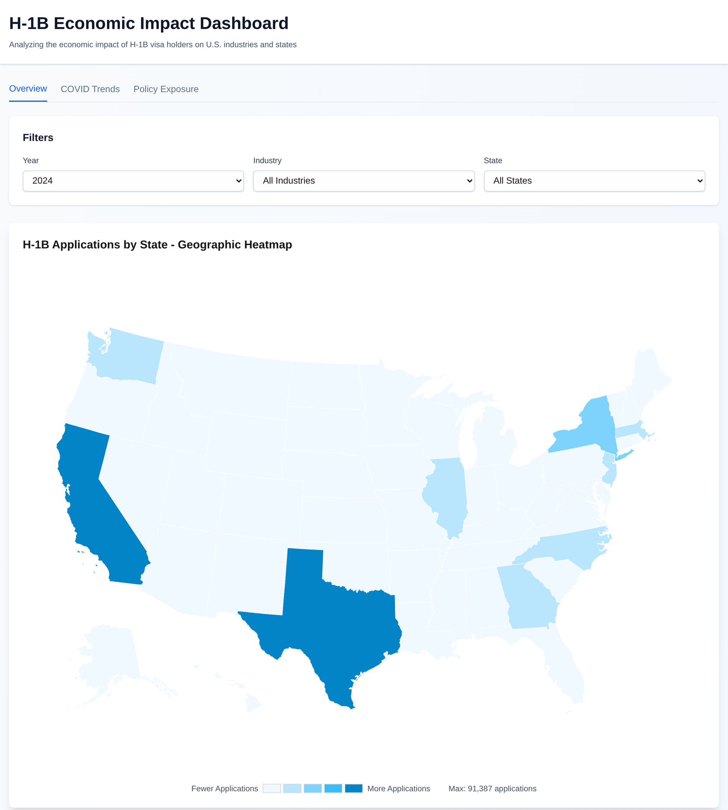
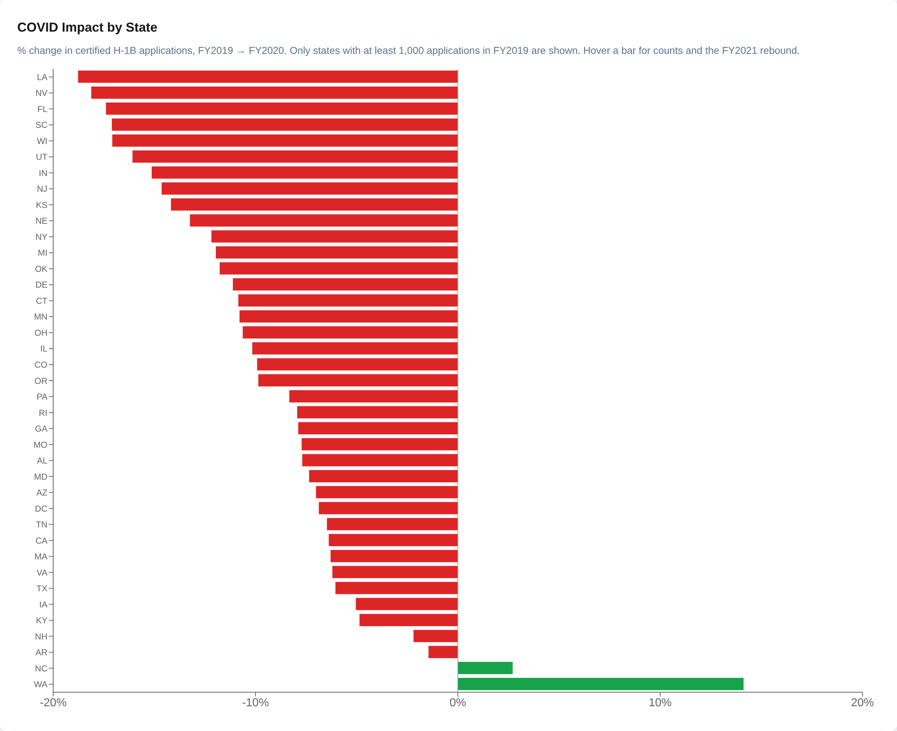
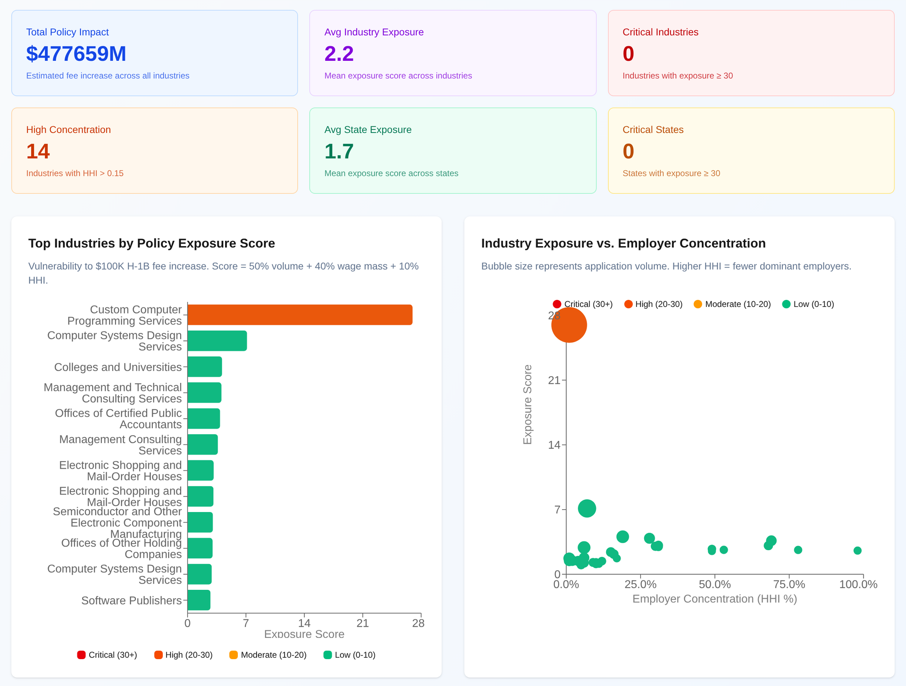

# H-1B Economic Impact Dashboard

An interactive dashboard of **7.4 million certified H-1B Labor Condition Applications (FY2009–2024)** from the U.S. Department of Labor, showing where H-1B workers are concentrated by state, industry and employer, how filings changed during COVID, and which industries and states are most exposed to a large per-application fee.

**Live dashboard: [h1-b-economic-impact-dashboard.vercel.app](https://h1-b-economic-impact-dashboard.vercel.app)**



Built as the final project for CS 554 (Advanced Database Systems) at Emory University, Fall 2025, by Jayden Bai, Unnati Agrawal and Avery Mattoon. After the course, the data pipeline was rebuilt to cover all 16 fiscal years and the dashboard was redeployed as a static site that needs no database.

---

## Key findings

**1. Filings peaked in FY2019 and have not returned to that level.** Certified H-1B applications grew from about 260,000 in FY2010 to 580,761 in FY2019, fell to 489,780 in FY2021 (−15.7% vs FY2019), and stood at 505,742 in FY2024.

**2. Half of all applications go to five states.** California (18.9%), Texas (10.9%), New York (8.6%), New Jersey (6.5%) and Illinois (5.0%) account for 49.9% of FY2009–2024 applications.

**3. One industry dominates.** Custom Computer Programming Services (NAICS 541511) accounts for 30.1% of all applications. Together with Computer Systems Design Services (541512), its share of each year's filings rose from 38.7% in FY2014 to 42.8% in FY2019, then fell to 33.5% in FY2024. Its median offered wage rose from $68,203 (FY2014) to $100,963 (FY2024), in nominal dollars.

**4. Employers differ widely on pay.** The top FY2024 filers were Amazon (14,373 applications), Cognizant (11,217), Ernst & Young (9,712), Tata Consultancy Services (9,606) and Microsoft (9,420). Median offered wages among the top eight ranged from $83,616 (TCS) to $203,350 (Meta).

**5. COVID cut filings almost everywhere, and the bigger drop came in FY2021.** Nationally, certified applications fell 7.7% from FY2019 to FY2020. 37 of the 39 states with at least 1,000 FY2019 applications declined, led by Louisiana (−18.8%), Nevada (−18.1%) and Florida (−17.4%); only North Carolina (+2.7%) and Washington (+14.1%) grew. Because the federal fiscal year starts in October, FY2021 (Oct 2020–Sep 2021) captures more of the pandemic, and most states fell further that year. Custom Computer Programming fell 20.7% in FY2020 and was 29.9% below FY2019 by FY2021, while Colleges and Universities grew 4.4%.



**6. Exposure to a $100,000 fee is concentrated in IT services and in California.** The Policy Exposure tab is a stress test that charges $100,000 for every certified application. Custom Computer Programming has by far the highest exposure score (27.0 out of 100; 31.8% of applications and 27.3% of wages). Among states, California scores highest (18.4), followed by Texas (9.6) and New York (8.1). At FY2024 volume, the fee would total about $50.6 billion in a single year.



---

## How to read the policy exposure model

The model is loosely based on the $100,000 fee on certain new H-1B petitions introduced by presidential proclamation in September 2025. It is an upper-bound stress test, not a forecast:

- It applies the fee to every certified application. The real fee applies only to some new petitions, and many certified applications never become petitions.
- The "Total Policy Impact" card ($477.7 billion) adds up all 16 years of applications. The single-year figure above is a better sense of scale.
- **Exposure score** = 50% share of applications + 40% share of total wages + 10% employer concentration. Concentration is measured with the Herfindahl–Hirschman Index (HHI) and capped at 0.25. Scores are computed on all FY2009–2024 applications pooled together.

---

## Data

**Source:** [U.S. Department of Labor, Office of Foreign Labor Certification, LCA disclosure data](https://www.dol.gov/agencies/eta/foreign-labor/performance), FY2009–FY2024.

**Scope:** applications with visa class H-1B and case status Certified, deduplicated by case number. That leaves 7,423,836 applications.

### Processing notes

The DOL files changed format many times over 16 years. These choices keep the years comparable:

- **Fiscal year comes from the file** (the year the case was decided), matching how DOL publishes its totals. The received date would push cases into the prior year.
- **Quarterly files are deduplicated.** From FY2020 on, DOL publishes quarterly files, and some of them are cumulative (FY2021 Q2 and Q3, FY2023 Q2). Duplicate case numbers are dropped on load.
- **Wages are annualized** from hourly, weekly, bi-weekly and monthly rates. Annual wages below $10,000 or above $5 million are treated as data-entry errors and left blank.
- **FY2019 worksites** are stored in columns ending in `_1` (`WORKSITE_STATE_1` and so on), unlike every other year. Without that mapping, worksites default to the employer's address, which would put all of Cognizant's 28,000 FY2019 applications in Texas.
- **State names** spelled out in some files ("CALIFORNIA") are converted to two-letter codes.
- **FY2009** comes from two filing systems with different layouts. The older one uses program codes instead of visa classes, old DOT occupation codes instead of SOC codes (stored with a `DOT-` prefix), and has no industry codes. FY2009 is included in state and employer totals but undercounts industries.
- **FY2010** has no unit for the offered wage, so the prevailing-wage unit is used.
- **FY2015** mixes day-first and month-first dates. Dates are not used in any analysis, so they are left as published.

### Known limitations

- An application (LCA) is filed before a petition. One LCA can cover several workers, and not every certified LCA leads to a hire, so these counts measure employer demand, not visas issued.
- Industry comes from the NAICS code each employer files under. Some large employers file under different entities or codes in different years, which causes implausible jumps for a few industries, such as Research and Development in Physical Sciences (+353% from FY2019 to FY2020) and Management Consulting Services (−59%).
- A few industry names correspond to more than one NAICS code, so they appear twice in some charts.
- Wages are nominal, not adjusted for inflation.

---

## How it works

```
DOL Excel files ──► data_cleaning.py ──► PostgreSQL ──► materialized views ──► export_static.py ──► frontend/data/*.json ──► Next.js on Vercel
   (raw, 16 yrs)     clean_all.py          (7.4M rows)     (by industry, state,    (summaries only,         (committed)              (API routes read JSON)
                     fix_cleaned.py        load_data_fast.py  employer, COVID,         ~15 MB)
                                                              exposure)
```

The full dataset lives in a local PostgreSQL database. Materialized views pre-aggregate it by industry, state, employer and year, and `export_static.py` writes those summaries to JSON. The deployed site serves only the JSON, so it runs on Vercel's free tier with no database.

**Tech stack:** PostgreSQL 16, Python (pandas, psycopg2), Next.js 16, React 19, TypeScript, Tailwind CSS, Recharts, react-simple-maps.

---

## Running it locally

The summary data is committed, so the dashboard runs without a database:

```bash
git clone https://github.com/averymattoon/H1-B-Economic-Impact-Dashboard.git
cd H1-B-Economic-Impact-Dashboard/frontend
npm install
npm run dev
```

Then open http://localhost:3000.

### Rebuilding the data from scratch

You only need this to change the data or the analysis. It needs PostgreSQL and the raw DOL Excel files. See [database/README.md](database/README.md) for more on the schema.

1. Download the H-1B/LCA disclosure files for FY2009–2024 from the DOL performance data page into `data/`.
2. Create the database and schema: `createdb h1b_economic_impact`, then `psql -d h1b_economic_impact -f database/schema.sql`, then load industry names with `python3 database/load_naics_lookup.py`.
3. Create `database/.env` with `DB_HOST`, `DB_PORT`, `DB_NAME`, `DB_USER` and `DB_PASSWORD`. This file is gitignored.
4. Clean the raw files. From `data/` (copy `data_cleaning.py`, `clean_all.py` and `fix_cleaned.py` there), run:
   ```bash
   python3 clean_all.py
   python3 fix_cleaned.py
   ```
5. Load and build the summary views. From `database/`:
   ```bash
   PYTHONHASHSEED=0 python3 load_data_fast.py --all
   psql -d h1b_economic_impact -f employer_metrics.sql
   psql -d h1b_economic_impact -f COVID_feature.sql
   psql -d h1b_economic_impact -f company_exposure.sql
   ```
   `PYTHONHASHSEED=0` keeps generated employer IDs stable across runs. Some years have no employer tax ID, so IDs are derived from employer names.
6. Export the summaries for the dashboard: `python3 export_static.py` (from `database/`).

---

## Project structure

```
H1-B-Economic-Impact-Dashboard/
├── frontend/
│   ├── app/
│   │   ├── api/                 # Routes that serve and filter the JSON summaries
│   │   └── page.tsx             # Dashboard (Overview, COVID Trends, Policy Exposure tabs)
│   ├── components/              # Charts, maps, filters and tables
│   ├── data/                    # Exported summary JSON (committed)
│   └── lib/staticData.ts        # Loads the JSON for the API routes
├── database/
│   ├── schema.sql               # Tables and core materialized views
│   ├── data_cleaning.py         # Maps each year's columns to one format
│   ├── clean_all.py             # Cleans every raw file in data/
│   ├── fix_cleaned.py           # Wage units and fiscal year by file
│   ├── load_data_fast.py        # Bulk loader into PostgreSQL
│   ├── employer_metrics.sql     # Employer summary view
│   ├── COVID_feature.sql        # FY2019–2021 comparison view
│   ├── company_exposure.sql     # Policy exposure scores
│   └── export_static.py         # Writes frontend/data/*.json
├── analysis/                    # Exploratory analysis from the course project
└── data/                        # Raw and cleaned files (not in Git)
```

---

## Team

Jayden Bai, Unnati Agrawal and Avery Mattoon. CS 554: Advanced Database Systems, Emory University, Fall 2025.

## Acknowledgments

- Data: [U.S. Department of Labor, Office of Foreign Labor Certification](https://www.dol.gov/agencies/eta/foreign-labor/performance)
- Maps: [us-atlas](https://github.com/topojson/us-atlas)
- Built with [Next.js](https://nextjs.org/), [Recharts](https://recharts.org/) and [react-simple-maps](https://www.react-simple-maps.io/)
